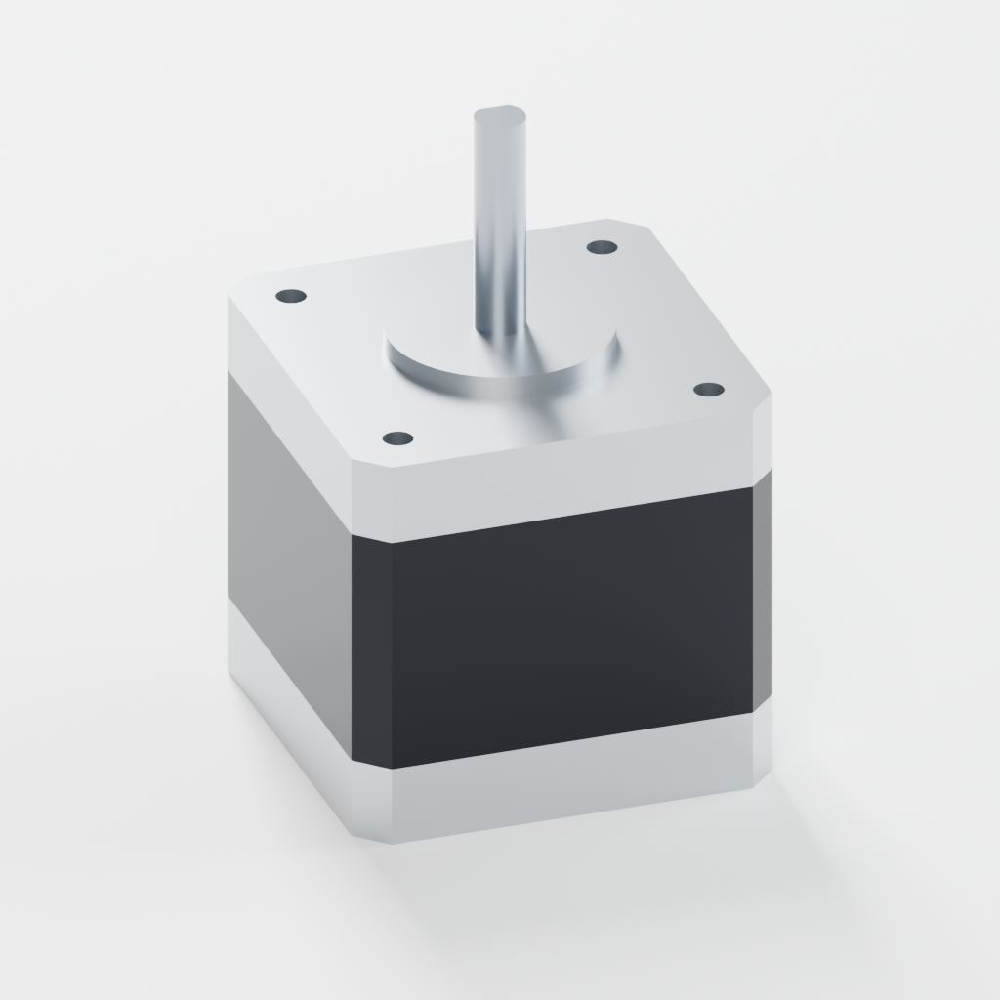

<!-- OOMP MOTOR GENERATED START -->
# OOMP motors

## Summary

A persistent catalogue of stepper motors, DC gearmotors, submersible pumps and computer fans. The first release contains 17 generic records, with editable geometry, drawings and studio renders.

Generated nominal layout model.

## Details

[OOMP base directory](https://github.com/oomlout/oomlout_oomp_version_5) · [Build and editing guide](README_GENERATOR.md) · [Taxonomy](TAXONOMY.md)

Manufacturer and part-number slots 14 and 15 are empty placeholders. N20 ratios are five common available options, not a measured popularity ranking. Pump envelope dimensions follow the supplied reference image; unlabelled rear features remain approximate. Its listing advertises separate voltage options, not a confirmed dual-voltage device.

## Parts

| Family | Records | Browse |
| --- | ---: | --- |
| dc gearmotor n20 | 5 | [Parts](navigation/dc_gearmotor_n20/README.md) |
| dc gearmotor tt | 3 | [Parts](navigation/dc_gearmotor_tt/README.md) |
| fan computer | 6 | [Parts](navigation/fan_computer/README.md) |
| pump submersible | 1 | [Parts](navigation/pump_submersible/README.md) |
| stepper | 2 | [Parts](navigation/stepper/README.md) |

## Assembly

Choose the closest nominal envelope, then verify the actual supplier, dimensions, voltage and interface before mechanical integration. No universal wiring or installation procedure is implied. Models identify purchased parts; they are not printable working motors.
<!-- OOMP MOTOR GENERATED END -->
