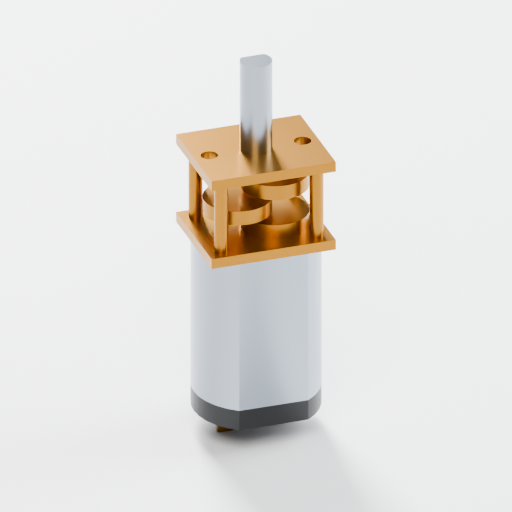

<!-- OOMP MOTOR GENERATED START -->
# Dc Gearmotor N20

[Catalogue](../../README.md)

| Variant | Preview |
| --- | --- |
| [motor dc gearmotor N20 6 volt 30 to 1 reduction](../../parts/motor_dc_gearmotor_n20_6_volt_30_to_1_reduction/README.md) |  |
| [motor dc gearmotor N20 6 volt 50 to 1 reduction](../../parts/motor_dc_gearmotor_n20_6_volt_50_to_1_reduction/README.md) |  |
| [motor dc gearmotor N20 6 volt 100 to 1 reduction](../../parts/motor_dc_gearmotor_n20_6_volt_100_to_1_reduction/README.md) |  |
| [motor dc gearmotor N20 6 volt 150 to 1 reduction](../../parts/motor_dc_gearmotor_n20_6_volt_150_to_1_reduction/README.md) |  |
| [motor dc gearmotor N20 6 volt 298 to 1 reduction](../../parts/motor_dc_gearmotor_n20_6_volt_298_to_1_reduction/README.md) |  |
<!-- OOMP MOTOR GENERATED END -->
