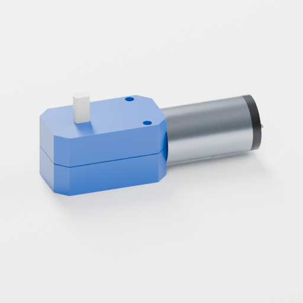
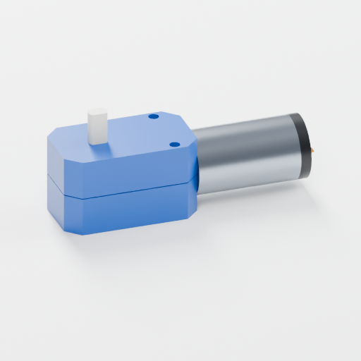
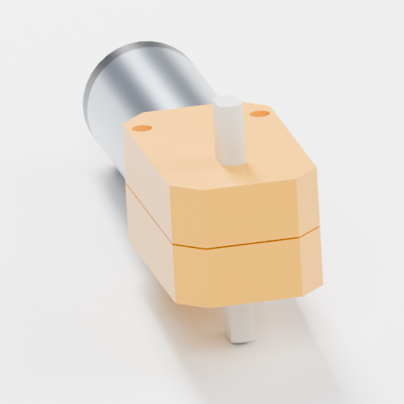

<!-- OOMP MOTOR GENERATED START -->
# Dc Gearmotor Tt

[Catalogue](../../README.md)

| Variant | Preview |
| --- | --- |
| [motor dc gearmotor tt all metal gear 6 volt 90 to 1 reduction](../../parts/motor_dc_gearmotor_tt_all_metal_gear_6_volt_90_to_1_reduction/README.md) |  |
| [motor dc gearmotor tt bi metal gear 6 volt 90 to 1 reduction](../../parts/motor_dc_gearmotor_tt_bi_metal_gear_6_volt_90_to_1_reduction/README.md) |  |
| [motor dc gearmotor tt plastic gear 6 volt 48 to 1 reduction](../../parts/motor_dc_gearmotor_tt_plastic_gear_6_volt_48_to_1_reduction/README.md) |  |
<!-- OOMP MOTOR GENERATED END -->
