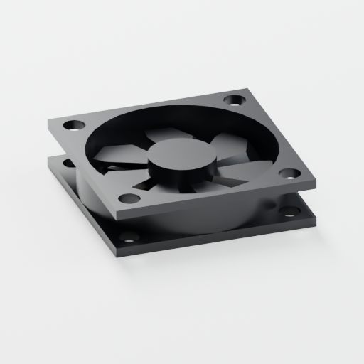
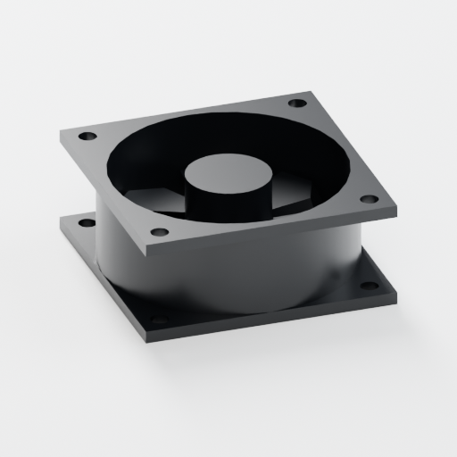
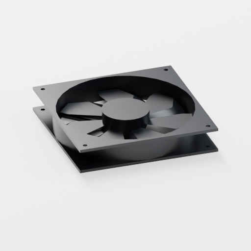

<!-- OOMP MOTOR GENERATED START -->
# Fan Computer

[Catalogue](../../README.md)

| Variant | Preview |
| --- | --- |
| [motor fan computer square axial 40 mm width 10 mm depth 12 volt](../../parts/motor_fan_computer_square_axial_40_mm_width_10_mm_depth_12_volt/README.md) |  |
| [motor fan computer square axial 60 mm width 25 mm depth 12 volt](../../parts/motor_fan_computer_square_axial_60_mm_width_25_mm_depth_12_volt/README.md) |  |
| [motor fan computer square axial 80 mm width 25 mm depth 12 volt](../../parts/motor_fan_computer_square_axial_80_mm_width_25_mm_depth_12_volt/README.md) |  |
| [motor fan computer square axial 92 mm width 25 mm depth 12 volt](../../parts/motor_fan_computer_square_axial_92_mm_width_25_mm_depth_12_volt/README.md) |  |
| [motor fan computer square axial 120 mm width 25 mm depth 12 volt](../../parts/motor_fan_computer_square_axial_120_mm_width_25_mm_depth_12_volt/README.md) |  |
| [motor fan computer square axial 140 mm width 25 mm depth 12 volt](../../parts/motor_fan_computer_square_axial_140_mm_width_25_mm_depth_12_volt/README.md) |  |
<!-- OOMP MOTOR GENERATED END -->
