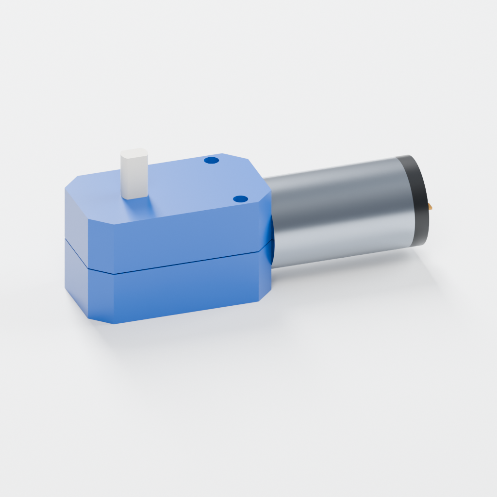

<!-- OOMP MOTOR GENERATED START -->
# motor dc gearmotor tt bi metal gear 6 volt 90 to 1 reduction

## Summary

Generic TT right-angle gearmotor. Gear construction describes internal gears; all variants have a plastic housing.



Generated layout model; not a product photograph.

## Details

ID: `motor_dc_gearmotor_tt_bi_metal_gear_6_volt_90_to_1_reduction`

Status: **nominal_generic**. Reference body envelope excludes shaft. Shaft profile, mounting holes and casing details are illustrative layout choices.

Nominal voltage: 6 V. Nominal reduction: 90:1.

| Dimension | mm |
| --- | ---: |
| body width | 70 |
| body height | 22 |
| body depth | 22 |
| gearbox length | 38 |
| motor diameter | 18 |
| shaft diameter | 5.4 |
| shaft length | 9 |
| shaft flat depth | 0.9 |
| shaft flat length | 9 |
| shaft centre x | -23 |
| mounting pitch | 17.5 |
| mounting hole diameter | 3 |

| Slot | Value | Purpose |
| --- | --- | --- |
| 1 | motor | Class: motor, including driven pumps and fans. |
| 2 | dc_gearmotor | Functional family. |
| 3 | tt | Frame, form factor or generic model series. |
| 4 | bi_metal_gear | Construction variant, e.g. gearbox gear material. |
| 5 | (empty) | Nominal body width / frame size where needed. |
| 6 | (empty) | Reserved: body height / diameter or secondary envelope. |
| 7 | (empty) | Nominal body depth excluding shaft / outlet. |
| 8 | 6_volt | Nominal voltage; empty for unknown or unselected options. |
| 9 | 90_to_1_reduction | Nominal input-to-output gear reduction. |
| 10 | (empty) | Reserved: winding / step angle / electrical variant. |
| 11 | (empty) | Reserved: speed / torque / flow performance grade. |
| 12 | (empty) | Reserved: shaft / mounting / outlet configuration. |
| 13 | (empty) | Reserved: encoder / connector / control / bearing option. |
| 14 | (empty) | Manufacturer placeholder; empty until selected. |
| 15 | (empty) | Manufacturer part number placeholder; empty until verified. |

Sources checked 2026-11-17:

- [Reference 1](https://www.adafruit.com/product/3801): Body dimensions, 3-6 V operating range, gear construction and nominal reduction.

<details><summary>Complete saved record</summary>

```yaml
family: dc_gearmotor_tt
form_factor: tt
construction: bi_metal_gear
voltage_v: 6
operating_voltage_range_v:
- 3
- 6
reduction_ratio: 90
housing_material: blue_plastic
description: Generic TT right-angle gearmotor. Gear construction describes internal
  gears; all variants have a plastic housing.
dimension_status: nominal_generic
dimension_note: Reference body envelope excludes shaft. Shaft profile, mounting holes
  and casing details are illustrative layout choices.
sources:
- url: https://www.adafruit.com/product/3801
  supports: Body dimensions, 3-6 V operating range, gear construction and nominal
    reduction.
catalogue_schema: oomp_motor_v5
dimensions_mm:
  body_width: 70.0
  body_height: 22.0
  body_depth: 22.0
  gearbox_length: 38.0
  motor_diameter: 18.0
  shaft_diameter: 5.4
  shaft_length: 9.0
  shaft_flat_depth: 0.9
  shaft_flat_length: 9.0
  shaft_centre_x: -23.0
  mounting_pitch: 17.5
  mounting_hole_diameter: 3.0
  dual_shaft: false
source_checked: '2026-11-17'
taxonomy_1: motor
taxonomy_2: dc_gearmotor
taxonomy_3: tt
taxonomy_4: bi_metal_gear
taxonomy_5: ''
taxonomy_6: ''
taxonomy_7: ''
taxonomy_8: 6_volt
taxonomy_9: 90_to_1_reduction
taxonomy_10: ''
taxonomy_11: ''
taxonomy_12: ''
taxonomy_13: ''
taxonomy_14: ''
taxonomy_15: ''
taxonomy_descriptions:
  taxonomy_1: 'Class: motor, including driven pumps and fans.'
  taxonomy_2: Functional family.
  taxonomy_3: Frame, form factor or generic model series.
  taxonomy_4: Construction variant, e.g. gearbox gear material.
  taxonomy_5: Nominal body width / frame size where needed.
  taxonomy_6: 'Reserved: body height / diameter or secondary envelope.'
  taxonomy_7: Nominal body depth excluding shaft / outlet.
  taxonomy_8: Nominal voltage; empty for unknown or unselected options.
  taxonomy_9: Nominal input-to-output gear reduction.
  taxonomy_10: 'Reserved: winding / step angle / electrical variant.'
  taxonomy_11: 'Reserved: speed / torque / flow performance grade.'
  taxonomy_12: 'Reserved: shaft / mounting / outlet configuration.'
  taxonomy_13: 'Reserved: encoder / connector / control / bearing option.'
  taxonomy_14: Manufacturer placeholder; empty until selected.
  taxonomy_15: Manufacturer part number placeholder; empty until verified.
specification_placeholders:
  manufacturer: ''
  manufacturer_part_number: ''
  rated_current_a: null
  no_load_speed_rpm: null
  torque_nm: null
  step_angle_degrees: null
  winding: null
  encoder: null
  connector: null
  bearing: null
oomp_id: motor_dc_gearmotor_tt_bi_metal_gear_6_volt_90_to_1_reduction
id: motor_dc_gearmotor_tt_bi_metal_gear_6_volt_90_to_1_reduction
name: motor dc gearmotor tt bi metal gear 6 volt 90 to 1 reduction
name_proper: motor dc gearmotor tt bi metal gear 6 volt 90 to 1 reduction
directory: parts/motor_dc_gearmotor_tt_bi_metal_gear_6_volt_90_to_1_reduction
model_note: Nominal external assembly for identification and layout; internal motor
  construction, exact gears, windings and flexible leads omitted. Not manufacturing
  geometry. Reference body envelope excludes shaft. Shaft profile, mounting holes
  and casing details are illustrative layout choices.
three_d_model_details:
  schema_version: 1
  generator: motor_csg_v1
  units: mm
  output_folder: three_d_model
  coordinate_system:
    origin: Body XY centre at lower body face; TT long body axis X.
    axis: +Z towards output shaft, pump outlet or fan front.
    stl_units: mm
    glb_units: metres
    glb_up_axis: Y
    glb_conversion: (x,y,z) mm -> (x,z,-y)/1000 metres
  parameters:
    family: dc_gearmotor_tt
    dimensions_mm:
      body_width: 70.0
      body_height: 22.0
      body_depth: 22.0
      gearbox_length: 38.0
      motor_diameter: 18.0
      shaft_diameter: 5.4
      shaft_length: 9.0
      shaft_flat_depth: 0.9
      shaft_flat_length: 9.0
      shaft_centre_x: -23.0
      mounting_pitch: 17.5
      mounting_hole_diameter: 3.0
      dual_shaft: false
    characteristic_dimension_mm: 70.0
    characteristic_dimension_basis: maximum nominal body dimension
  modelling_note: Nominal external assembly for identification and layout; internal
    motor construction, exact gears, windings and flexible leads omitted. Not manufacturing
    geometry. Reference body envelope excludes shaft. Shaft profile, mounting holes
    and casing details are illustrative layout choices.
  variants:
    full:
      angular_segments: 96
    display:
      angular_segments: 32
  components:
  - name: housing_half_0
    material: blue_plastic
    node:
      shape: difference
      children:
      - shape: polygon
        points: &id001
        - - -35.0
          - -7.0
        - - -31.0
          - -11.0
        - - -1.0
          - -11.0
        - - 3.0
          - -7.0
        - - 3.0
          - 7.0
        - - -1.0
          - 11.0
        - - -31.0
          - 11.0
        - - -35.0
          - 7.0
        depth: 10.88
        pos:
        - 0
        - 0
        - 0
        rot:
        - 0
        - 0
        - 0
        twist: 0
        slices: 12
      - shape: cylinder
        diameter: 3.0
        depth: 22.2
        pos:
        - -4.0
        - -8.75
        - -0.1
        rot:
        - 0
        - 0
        - 0
      - shape: cylinder
        diameter: 3.0
        depth: 22.2
        pos:
        - -4.0
        - 8.75
        - -0.1
        rot:
        - 0
        - 0
        - 0
      pos:
      - 0
      - 0
      - 0
      rot:
      - 0
      - 0
      - 0
  - name: housing_half_1
    material: blue_plastic
    node:
      shape: difference
      children:
      - shape: polygon
        points: *id001
        depth: 10.88
        pos:
        - 0
        - 0
        - 11.12
        rot:
        - 0
        - 0
        - 0
        twist: 0
        slices: 12
      - shape: cylinder
        diameter: 3.0
        depth: 22.2
        pos:
        - -4.0
        - -8.75
        - -0.1
        rot:
        - 0
        - 0
        - 0
      - shape: cylinder
        diameter: 3.0
        depth: 22.2
        pos:
        - -4.0
        - 8.75
        - -0.1
        rot:
        - 0
        - 0
        - 0
      pos:
      - 0
      - 0
      - 0
      rot:
      - 0
      - 0
      - 0
  - name: motor_can
    material: steel
    node:
      shape: cylinder
      diameter: 18.0
      depth: 29.0
      pos:
      - 3.0
      - 0
      - 11.0
      rot:
      - 0
      - 90
      - 0
  - name: motor_end_cap
    material: black_plastic
    node:
      shape: cylinder
      diameter: 18.0
      depth: 3
      pos:
      - 32.0
      - 0
      - 11.0
      rot:
      - 0
      - 90
      - 0
  - name: output_shaft
    material: white_plastic
    node:
      shape: difference
      children:
      - shape: cylinder
        diameter: 5.4
        depth: 9.0
        pos:
        - 0
        - 0
        - 0
        rot:
        - 0
        - 0
        - 0
      - shape: box
        size:
        - 10.8
        - 5.4
        - 9.02
        pos:
        - 0
        - -4.5
        - -0.01
        rot:
        - 0
        - 0
        - 0
      - shape: box
        size:
        - 10.8
        - 5.4
        - 9.02
        pos:
        - 0
        - 4.5
        - -0.01
        rot:
        - 0
        - 0
        - 0
      pos:
      - -23.0
      - 0
      - 22.0
      rot:
      - 0
      - 0
      - 0
  - name: terminal_-4
    material: brass
    node:
      shape: box
      size:
      - 2
      - 2
      - 0.5
      pos:
      - 36.0
      - -4
      - 11.0
      rot:
      - 0
      - 0
      - 0
  - name: terminal_4
    material: brass
    node:
      shape: box
      size:
      - 2
      - 2
      - 0.5
      pos:
      - 36.0
      - 4
      - 11.0
      rot:
      - 0
      - 0
      - 0
  material:
    name: Satin steel
    base_colour_srgb:
    - 0.62
    - 0.65
    - 0.69
    metallic: 1.0
    roughness: 0.26
    roughness_variation: 0.045
    coat_weight: 0.02
    coat_roughness: 0.28
    microtexture_spacing_mm: 0.025
    microtexture_height_um: 0.8
    note: Visual finish approximation; catalogue specifies colour only.
  studio:
    engine: cycles
    device: auto
    seed: 7991
    low_samples: 48
    high_samples: 96
    adaptive_threshold: 0.015
    denoise: true
    view_transform: AgX
    look: AgX - Medium High Contrast
    exposure: 0.0
    world_colour:
    - 0.78
    - 0.82
    - 0.9
    world_strength: 0.35
    floor_colour_srgb:
    - 0.93
    - 0.935
    - 0.94
    floor_roughness: 0.55
    framing_margin: 0.13
    lights:
    - name: Key softbox
      position:
      - -3
      - -4
      - 6
      power: 650.0
      width: 4.0
      height: 5.0
      colour:
      - 1.0
      - 0.96
      - 0.9
    - name: Fill softbox
      position:
      - 4
      - -1
      - 3
      power: 330.0
      width: 3.0
      height: 4.0
      colour:
      - 0.9
      - 0.95
      - 1.0
    - name: Rim strip
      position:
      - 1
      - 4
      - 4
      power: 850.0
      width: 1.2
      height: 5.0
      colour:
      - 1.0
      - 1.0
      - 1.0
    poses:
      isometric:
        camera_eye:
        - 1
        - -1
        - 1
        projection: orthographic
        orientation: principal axis Z up
      product:
        camera_eye:
        - -6
        - -10
        - 6
        projection: orthographic
        orientation: resting on lower body face
        yaw_degrees: -12.0
        support: Stable convex-hull support using actual mesh centre of mass.
        resting_axis: face
    reference: 'OOMP hardware / bearing studio: same three softboxes, floor, AgX and
      metal microtexture; expanded material palette.'
  renders:
    low:
      file: render_low.png
      variant: display
      pixels: 512
      view: isometric
    high:
      file: render_high.png
      variant: full
      pixels: 1024
      view: isometric
    product_low:
      file: render_product_low.png
      variant: display
      pixels: 512
      view: product
    product_high:
      file: render_product_high.png
      variant: full
      pixels: 1024
      view: product
  materials:
    steel:
      name: Satin steel
      base_colour_srgb:
      - 0.62
      - 0.65
      - 0.69
      metallic: 1.0
      roughness: 0.26
      roughness_variation: 0.045
      coat_weight: 0.02
      coat_roughness: 0.28
      microtexture_spacing_mm: 0.025
      microtexture_height_um: 0.8
      note: Visual material approximation; no exact alloy or polymer grade asserted.
    aluminium:
      name: Cast aluminium end plates
      base_colour_srgb:
      - 0.72
      - 0.74
      - 0.76
      metallic: 0.9
      roughness: 0.32
      roughness_variation: 0.045
      coat_weight: 0.02
      coat_roughness: 0.28
      microtexture_spacing_mm: 0.025
      microtexture_height_um: 0.8
      note: Visual material approximation; no exact alloy or polymer grade asserted.
    brass:
      name: Brass gearbox plates
      base_colour_srgb:
      - 0.67
      - 0.48
      - 0.2
      metallic: 0.9
      roughness: 0.3
      roughness_variation: 0.045
      coat_weight: 0.02
      coat_roughness: 0.28
      microtexture_spacing_mm: 0.025
      microtexture_height_um: 0.8
      note: Visual material approximation; no exact alloy or polymer grade asserted.
    black_metal:
      name: Black coated motor body
      base_colour_srgb:
      - 0.12
      - 0.13
      - 0.15
      metallic: 0.65
      roughness: 0.33
      roughness_variation: 0.045
      coat_weight: 0.02
      coat_roughness: 0.28
      microtexture_spacing_mm: 0.025
      microtexture_height_um: 0.8
      note: Visual material approximation; no exact alloy or polymer grade asserted.
    black_plastic:
      name: Black moulded polymer
      base_colour_srgb:
      - 0.065
      - 0.075
      - 0.09
      metallic: 0.0
      roughness: 0.34
      roughness_variation: 0.045
      coat_weight: 0.02
      coat_roughness: 0.28
      microtexture_spacing_mm: 0.025
      microtexture_height_um: 0.8
      note: Visual material approximation; no exact alloy or polymer grade asserted.
    grey_plastic:
      name: Grey pump housing
      base_colour_srgb:
      - 0.42
      - 0.45
      - 0.48
      metallic: 0.0
      roughness: 0.36
      roughness_variation: 0.045
      coat_weight: 0.02
      coat_roughness: 0.28
      microtexture_spacing_mm: 0.025
      microtexture_height_um: 0.8
      note: Visual material approximation; no exact alloy or polymer grade asserted.
    yellow_plastic:
      name: Yellow TT housing
      base_colour_srgb:
      - 0.96
      - 0.68
      - 0.035
      metallic: 0.0
      roughness: 0.32
      roughness_variation: 0.045
      coat_weight: 0.02
      coat_roughness: 0.28
      microtexture_spacing_mm: 0.025
      microtexture_height_um: 0.8
      note: Visual material approximation; no exact alloy or polymer grade asserted.
    blue_plastic:
      name: Blue TT housing
      base_colour_srgb:
      - 0.075
      - 0.34
      - 0.68
      metallic: 0.0
      roughness: 0.32
      roughness_variation: 0.045
      coat_weight: 0.02
      coat_roughness: 0.28
      microtexture_spacing_mm: 0.025
      microtexture_height_um: 0.8
      note: Visual material approximation; no exact alloy or polymer grade asserted.
    white_plastic:
      name: Natural nylon shaft
      base_colour_srgb:
      - 0.86
      - 0.85
      - 0.81
      metallic: 0.0
      roughness: 0.38
      roughness_variation: 0.045
      coat_weight: 0.02
      coat_roughness: 0.28
      microtexture_spacing_mm: 0.025
      microtexture_height_um: 0.8
      note: Visual material approximation; no exact alloy or polymer grade asserted.
oobb_type: motor
oobb_details:
  oobb_type: motor
  oobb_name: dc_gearmotor_tt
  run_scad: true
  run_solidcraft: false
  recipe_source: three_d_model_details
  units: mm
svg_details:
  svg_name: motor_mechanical_drawing
  filename: working_mechanical_drawing
  sheet_width_mm: 297
  sheet_height_mm: 210
  ink: '#183336'
  accent: '#147d83'
  muted: '#61767a'
  paper: '#ffffff'
  font_family: Arial, sans-serif
  line_width_mm: 0.35
  dimensions_mm:
    body_width: 70.0
    body_height: 22.0
    body_depth: 22.0
    gearbox_length: 38.0
    motor_diameter: 18.0
    shaft_diameter: 5.4
    shaft_length: 9.0
    shaft_flat_depth: 0.9
    shaft_flat_length: 9.0
    shaft_centre_x: -23.0
    mounting_pitch: 17.5
    mounting_hole_diameter: 3.0
    dual_shaft: false
```

</details>

[Canonical YAML](working.yaml)

## Parts

[OpenSCAD](working.scad) · [SVG drawing](working_mechanical_drawing.svg) · [Full STL (mm)](three_d_model/model_full.stl) · [Full GLB (metres)](three_d_model/model_full.glb) · [Blender studio](three_d_model/studio.blend) · [Portable model script](three_d_model/model.py) · [Saved recipe](three_d_model/parameters.json)

These are alternate representations of one purchased component, not separate BOM items.

## Assembly

Nominal external assembly for identification and layout; internal motor construction, exact gears, windings and flexible leads omitted. Not manufacturing geometry. Reference body envelope excludes shaft. Shaft profile, mounting holes and casing details are illustrative layout choices. No supplier-specific assembly or wiring procedure has been established.

[Catalogue](../../README.md) · [Regeneration](../../README_GENERATOR.md)
<!-- OOMP MOTOR GENERATED END -->
