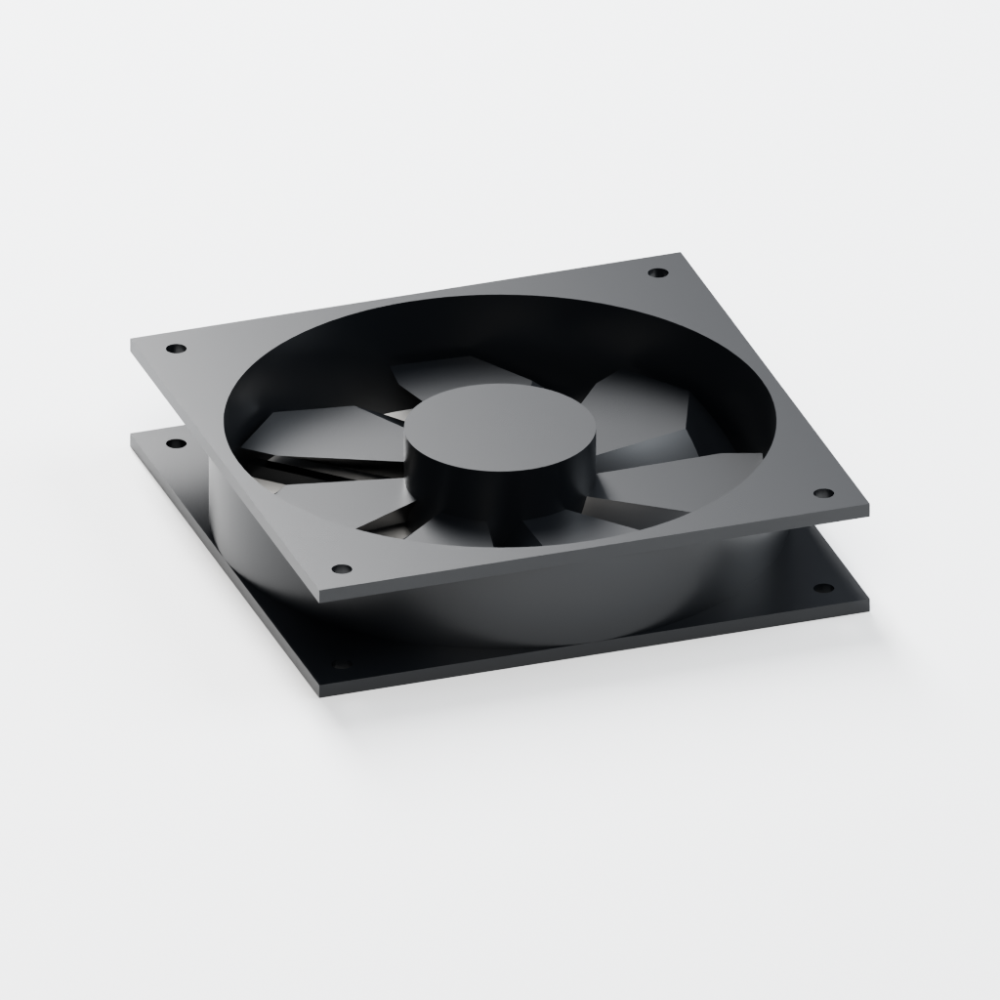

<!-- OOMP MOTOR GENERATED START -->
# motor fan computer square axial 120 mm width 25 mm depth 12 volt

## Summary

Generic square computer fan; speed, airflow, bearing, connector and control unspecified.



Generated layout model; not a product photograph.

## Details

ID: `motor_fan_computer_square_axial_120_mm_width_25_mm_depth_12_volt`

Status: **nominal_generic**. Nominal envelope and mounting pattern. Hub and blades are illustrative, not aerodynamic designs. The 40 x 10 mm label is nominal (reference physical depth can be 11 mm). Confirm actual supplier before mounting.

Nominal voltage: 12 V. Nominal reduction: not specified.

| Dimension | mm |
| --- | ---: |
| body width | 120 |
| body height | 120 |
| body depth | 25 |
| mounting pitch | 105 |
| mounting hole diameter | 4.3 |
| frame wall | 3 |
| flange depth | 3 |

| Slot | Value | Purpose |
| --- | --- | --- |
| 1 | motor | Class: motor, including driven pumps and fans. |
| 2 | fan_computer | Functional family. |
| 3 | square_axial | Frame, form factor or generic model series. |
| 4 | (empty) | Construction variant, e.g. gearbox gear material. |
| 5 | 120_mm_width | Nominal body width / frame size where needed. |
| 6 | (empty) | Reserved: body height / diameter or secondary envelope. |
| 7 | 25_mm_depth | Nominal body depth excluding shaft / outlet. |
| 8 | 12_volt | Nominal voltage; empty for unknown or unselected options. |
| 9 | (empty) | Nominal input-to-output gear reduction. |
| 10 | (empty) | Reserved: winding / step angle / electrical variant. |
| 11 | (empty) | Reserved: speed / torque / flow performance grade. |
| 12 | (empty) | Reserved: shaft / mounting / outlet configuration. |
| 13 | (empty) | Reserved: encoder / connector / control / bearing option. |
| 14 | (empty) | Manufacturer placeholder; empty until selected. |
| 15 | (empty) | Manufacturer part number placeholder; empty until verified. |

Sources checked 2026-11-17:

- [Reference 1](https://www.noctua.at/en/products/nf-a12x25-pwm/specifications): Reference form factor / mounting pattern only; branded performance and geometry not inherited.

<details><summary>Complete saved record</summary>

```yaml
family: fan_computer
form_factor: square_axial
construction: ''
voltage_v: 12
reduction_ratio: null
description: Generic square computer fan; speed, airflow, bearing, connector and control
  unspecified.
dimension_status: nominal_generic
dimension_note: Nominal envelope and mounting pattern. Hub and blades are illustrative,
  not aerodynamic designs. The 40 x 10 mm label is nominal (reference physical depth
  can be 11 mm). Confirm actual supplier before mounting.
sources:
- url: https://www.noctua.at/en/products/nf-a12x25-pwm/specifications
  supports: Reference form factor / mounting pattern only; branded performance and
    geometry not inherited.
catalogue_schema: oomp_motor_v5
dimensions_mm:
  body_width: 120
  body_height: 120
  body_depth: 25
  mounting_pitch: 105
  mounting_hole_diameter: 4.3
  frame_wall: 3.0
  flange_depth: 3.0
  blade_count: 7
source_checked: '2026-11-17'
taxonomy_1: motor
taxonomy_2: fan_computer
taxonomy_3: square_axial
taxonomy_4: ''
taxonomy_5: 120_mm_width
taxonomy_6: ''
taxonomy_7: 25_mm_depth
taxonomy_8: 12_volt
taxonomy_9: ''
taxonomy_10: ''
taxonomy_11: ''
taxonomy_12: ''
taxonomy_13: ''
taxonomy_14: ''
taxonomy_15: ''
taxonomy_descriptions:
  taxonomy_1: 'Class: motor, including driven pumps and fans.'
  taxonomy_2: Functional family.
  taxonomy_3: Frame, form factor or generic model series.
  taxonomy_4: Construction variant, e.g. gearbox gear material.
  taxonomy_5: Nominal body width / frame size where needed.
  taxonomy_6: 'Reserved: body height / diameter or secondary envelope.'
  taxonomy_7: Nominal body depth excluding shaft / outlet.
  taxonomy_8: Nominal voltage; empty for unknown or unselected options.
  taxonomy_9: Nominal input-to-output gear reduction.
  taxonomy_10: 'Reserved: winding / step angle / electrical variant.'
  taxonomy_11: 'Reserved: speed / torque / flow performance grade.'
  taxonomy_12: 'Reserved: shaft / mounting / outlet configuration.'
  taxonomy_13: 'Reserved: encoder / connector / control / bearing option.'
  taxonomy_14: Manufacturer placeholder; empty until selected.
  taxonomy_15: Manufacturer part number placeholder; empty until verified.
specification_placeholders:
  manufacturer: ''
  manufacturer_part_number: ''
  rated_current_a: null
  no_load_speed_rpm: null
  torque_nm: null
  step_angle_degrees: null
  winding: null
  encoder: null
  connector: null
  bearing: null
oomp_id: motor_fan_computer_square_axial_120_mm_width_25_mm_depth_12_volt
id: motor_fan_computer_square_axial_120_mm_width_25_mm_depth_12_volt
name: motor fan computer square axial 120 mm width 25 mm depth 12 volt
name_proper: motor fan computer square axial 120 mm width 25 mm depth 12 volt
directory: parts/motor_fan_computer_square_axial_120_mm_width_25_mm_depth_12_volt
model_note: Nominal external assembly for identification and layout; internal motor
  construction, exact gears, windings and flexible leads omitted. Not manufacturing
  geometry. Nominal envelope and mounting pattern. Hub and blades are illustrative,
  not aerodynamic designs. The 40 x 10 mm label is nominal (reference physical depth
  can be 11 mm). Confirm actual supplier before mounting.
three_d_model_details:
  schema_version: 1
  generator: motor_csg_v1
  units: mm
  output_folder: three_d_model
  coordinate_system:
    origin: Body XY centre at lower body face; TT long body axis X.
    axis: +Z towards output shaft, pump outlet or fan front.
    stl_units: mm
    glb_units: metres
    glb_up_axis: Y
    glb_conversion: (x,y,z) mm -> (x,z,-y)/1000 metres
  parameters:
    family: fan_computer
    dimensions_mm:
      body_width: 120
      body_height: 120
      body_depth: 25
      mounting_pitch: 105
      mounting_hole_diameter: 4.3
      frame_wall: 3.0
      flange_depth: 3.0
      blade_count: 7
    characteristic_dimension_mm: 120
    characteristic_dimension_basis: maximum nominal body dimension
  modelling_note: Nominal external assembly for identification and layout; internal
    motor construction, exact gears, windings and flexible leads omitted. Not manufacturing
    geometry. Nominal envelope and mounting pattern. Hub and blades are illustrative,
    not aerodynamic designs. The 40 x 10 mm label is nominal (reference physical depth
    can be 11 mm). Confirm actual supplier before mounting.
  variants:
    full:
      angular_segments: 96
    display:
      angular_segments: 32
  components:
  - name: mounting_flange_0
    material: black_plastic
    node:
      shape: difference
      children:
      - shape: box
        size:
        - 120
        - 120
        - 3.0
        pos:
        - 0
        - 0
        - 0
        rot:
        - 0
        - 0
        - 0
      - shape: cylinder
        diameter: 114.0
        depth: 3.2
        pos:
        - 0
        - 0
        - -0.1
        rot:
        - 0
        - 0
        - 0
      - shape: cylinder
        diameter: 4.3
        depth: 3.2
        pos:
        - -52.5
        - -52.5
        - -0.1
        rot:
        - 0
        - 0
        - 0
      - shape: cylinder
        diameter: 4.3
        depth: 3.2
        pos:
        - -52.5
        - 52.5
        - -0.1
        rot:
        - 0
        - 0
        - 0
      - shape: cylinder
        diameter: 4.3
        depth: 3.2
        pos:
        - 52.5
        - -52.5
        - -0.1
        rot:
        - 0
        - 0
        - 0
      - shape: cylinder
        diameter: 4.3
        depth: 3.2
        pos:
        - 52.5
        - 52.5
        - -0.1
        rot:
        - 0
        - 0
        - 0
      pos:
      - 0
      - 0
      - 0
      rot:
      - 0
      - 0
      - 0
  - name: mounting_flange_1
    material: black_plastic
    node:
      shape: difference
      children:
      - shape: box
        size:
        - 120
        - 120
        - 3.0
        pos:
        - 0
        - 0
        - 22.0
        rot:
        - 0
        - 0
        - 0
      - shape: cylinder
        diameter: 114.0
        depth: 3.2
        pos:
        - 0
        - 0
        - 21.9
        rot:
        - 0
        - 0
        - 0
      - shape: cylinder
        diameter: 4.3
        depth: 3.2
        pos:
        - -52.5
        - -52.5
        - 21.9
        rot:
        - 0
        - 0
        - 0
      - shape: cylinder
        diameter: 4.3
        depth: 3.2
        pos:
        - -52.5
        - 52.5
        - 21.9
        rot:
        - 0
        - 0
        - 0
      - shape: cylinder
        diameter: 4.3
        depth: 3.2
        pos:
        - 52.5
        - -52.5
        - 21.9
        rot:
        - 0
        - 0
        - 0
      - shape: cylinder
        diameter: 4.3
        depth: 3.2
        pos:
        - 52.5
        - 52.5
        - 21.9
        rot:
        - 0
        - 0
        - 0
      pos:
      - 0
      - 0
      - 0
      rot:
      - 0
      - 0
      - 0
  - name: fan_duct
    material: black_plastic
    node:
      shape: difference
      children:
      - shape: cylinder
        diameter: 120
        depth: 19.0
        pos:
        - 0
        - 0
        - 3.0
        rot:
        - 0
        - 0
        - 0
      - shape: cylinder
        diameter: 114.0
        depth: 25
        pos:
        - 0
        - 0
        - 0
        rot:
        - 0
        - 0
        - 0
      pos:
      - 0
      - 0
      - 0
      rot:
      - 0
      - 0
      - 0
  - name: rear_support_0
    material: black_plastic
    node:
      shape: union
      children:
      - shape: box
        size:
        - 60.0
        - 3.0
        - 3.0
        pos:
        - 30.0
        - 0
        - 0
        rot:
        - 0
        - 0
        - 0
      pos:
      - 0
      - 0
      - 0
      rot:
      - 0
      - 0
      - 45
  - name: rear_support_1
    material: black_plastic
    node:
      shape: union
      children:
      - shape: box
        size:
        - 60.0
        - 3.0
        - 3.0
        pos:
        - 30.0
        - 0
        - 0
        rot:
        - 0
        - 0
        - 0
      pos:
      - 0
      - 0
      - 0
      rot:
      - 0
      - 0
      - 135
  - name: rear_support_2
    material: black_plastic
    node:
      shape: union
      children:
      - shape: box
        size:
        - 60.0
        - 3.0
        - 3.0
        pos:
        - 30.0
        - 0
        - 0
        rot:
        - 0
        - 0
        - 0
      pos:
      - 0
      - 0
      - 0
      rot:
      - 0
      - 0
      - 225
  - name: rear_support_3
    material: black_plastic
    node:
      shape: union
      children:
      - shape: box
        size:
        - 60.0
        - 3.0
        - 3.0
        pos:
        - 30.0
        - 0
        - 0
        rot:
        - 0
        - 0
        - 0
      pos:
      - 0
      - 0
      - 0
      rot:
      - 0
      - 0
      - 315
  - name: motor_hub
    material: black_plastic
    node:
      shape: cylinder
      diameter: 39.6
      depth: 20.5
      pos:
      - 0
      - 0
      - 3.0
      rot:
      - 0
      - 0
      - 0
  - name: blade_1
    material: black_plastic
    node:
      shape: polygon
      points: &id001
      - - 16.65589734529524
        - -3.5403202712448056
      - - 43.83083805648078
        - -5.381750204771313
      - - 54.662797394534685
        - 7.682355172995613
      - - 49.61343135571402
        - 24.198087302757074
      - - 41.427901056940854
        - 22.027605725913997
      - - 16.283957384538567
        - 4.978505388018761
      depth: 8.0
      pos:
      - 0
      - 0
      - 3.9000000000000004
      rot:
      - 0
      - 0
      - 0.0
      twist: 18
      slices: 12
  - name: blade_2
    material: black_plastic
    node:
      shape: polygon
      points: *id001
      depth: 8.0
      pos:
      - 0
      - 0
      - 3.9000000000000004
      rot:
      - 0
      - 0
      - 51.42857142857143
      twist: 18
      slices: 12
  - name: blade_3
    material: black_plastic
    node:
      shape: polygon
      points: *id001
      depth: 8.0
      pos:
      - 0
      - 0
      - 3.9000000000000004
      rot:
      - 0
      - 0
      - 102.85714285714286
      twist: 18
      slices: 12
  - name: blade_4
    material: black_plastic
    node:
      shape: polygon
      points: *id001
      depth: 8.0
      pos:
      - 0
      - 0
      - 3.9000000000000004
      rot:
      - 0
      - 0
      - 154.28571428571428
      twist: 18
      slices: 12
  - name: blade_5
    material: black_plastic
    node:
      shape: polygon
      points: *id001
      depth: 8.0
      pos:
      - 0
      - 0
      - 3.9000000000000004
      rot:
      - 0
      - 0
      - 205.71428571428572
      twist: 18
      slices: 12
  - name: blade_6
    material: black_plastic
    node:
      shape: polygon
      points: *id001
      depth: 8.0
      pos:
      - 0
      - 0
      - 3.9000000000000004
      rot:
      - 0
      - 0
      - 257.14285714285717
      twist: 18
      slices: 12
  - name: blade_7
    material: black_plastic
    node:
      shape: polygon
      points: *id001
      depth: 8.0
      pos:
      - 0
      - 0
      - 3.9000000000000004
      rot:
      - 0
      - 0
      - 308.57142857142856
      twist: 18
      slices: 12
  material:
    name: Satin steel
    base_colour_srgb:
    - 0.62
    - 0.65
    - 0.69
    metallic: 1.0
    roughness: 0.26
    roughness_variation: 0.045
    coat_weight: 0.02
    coat_roughness: 0.28
    microtexture_spacing_mm: 0.025
    microtexture_height_um: 0.8
    note: Visual finish approximation; catalogue specifies colour only.
  studio:
    engine: cycles
    device: auto
    seed: 7991
    low_samples: 48
    high_samples: 96
    adaptive_threshold: 0.015
    denoise: true
    view_transform: AgX
    look: AgX - Medium High Contrast
    exposure: 0.0
    world_colour:
    - 0.78
    - 0.82
    - 0.9
    world_strength: 0.35
    floor_colour_srgb:
    - 0.93
    - 0.935
    - 0.94
    floor_roughness: 0.55
    framing_margin: 0.13
    lights:
    - name: Key softbox
      position:
      - -3
      - -4
      - 6
      power: 650.0
      width: 4.0
      height: 5.0
      colour:
      - 1.0
      - 0.96
      - 0.9
    - name: Fill softbox
      position:
      - 4
      - -1
      - 3
      power: 330.0
      width: 3.0
      height: 4.0
      colour:
      - 0.9
      - 0.95
      - 1.0
    - name: Rim strip
      position:
      - 1
      - 4
      - 4
      power: 850.0
      width: 1.2
      height: 5.0
      colour:
      - 1.0
      - 1.0
      - 1.0
    poses:
      isometric:
        camera_eye:
        - 1
        - -1
        - 1
        projection: orthographic
        orientation: principal axis Z up
      product:
        camera_eye:
        - -6
        - -10
        - 6
        projection: orthographic
        orientation: resting on lower body face
        yaw_degrees: -12.0
        support: Stable convex-hull support using actual mesh centre of mass.
        resting_axis: face
    reference: 'OOMP hardware / bearing studio: same three softboxes, floor, AgX and
      metal microtexture; expanded material palette.'
  renders:
    low:
      file: render_low.png
      variant: display
      pixels: 512
      view: isometric
    high:
      file: render_high.png
      variant: full
      pixels: 1024
      view: isometric
    product_low:
      file: render_product_low.png
      variant: display
      pixels: 512
      view: product
    product_high:
      file: render_product_high.png
      variant: full
      pixels: 1024
      view: product
  materials:
    steel:
      name: Satin steel
      base_colour_srgb:
      - 0.62
      - 0.65
      - 0.69
      metallic: 1.0
      roughness: 0.26
      roughness_variation: 0.045
      coat_weight: 0.02
      coat_roughness: 0.28
      microtexture_spacing_mm: 0.025
      microtexture_height_um: 0.8
      note: Visual material approximation; no exact alloy or polymer grade asserted.
    aluminium:
      name: Cast aluminium end plates
      base_colour_srgb:
      - 0.72
      - 0.74
      - 0.76
      metallic: 0.9
      roughness: 0.32
      roughness_variation: 0.045
      coat_weight: 0.02
      coat_roughness: 0.28
      microtexture_spacing_mm: 0.025
      microtexture_height_um: 0.8
      note: Visual material approximation; no exact alloy or polymer grade asserted.
    brass:
      name: Brass gearbox plates
      base_colour_srgb:
      - 0.67
      - 0.48
      - 0.2
      metallic: 0.9
      roughness: 0.3
      roughness_variation: 0.045
      coat_weight: 0.02
      coat_roughness: 0.28
      microtexture_spacing_mm: 0.025
      microtexture_height_um: 0.8
      note: Visual material approximation; no exact alloy or polymer grade asserted.
    black_metal:
      name: Black coated motor body
      base_colour_srgb:
      - 0.12
      - 0.13
      - 0.15
      metallic: 0.65
      roughness: 0.33
      roughness_variation: 0.045
      coat_weight: 0.02
      coat_roughness: 0.28
      microtexture_spacing_mm: 0.025
      microtexture_height_um: 0.8
      note: Visual material approximation; no exact alloy or polymer grade asserted.
    black_plastic:
      name: Black moulded polymer
      base_colour_srgb:
      - 0.065
      - 0.075
      - 0.09
      metallic: 0.0
      roughness: 0.34
      roughness_variation: 0.045
      coat_weight: 0.02
      coat_roughness: 0.28
      microtexture_spacing_mm: 0.025
      microtexture_height_um: 0.8
      note: Visual material approximation; no exact alloy or polymer grade asserted.
    grey_plastic:
      name: Grey pump housing
      base_colour_srgb:
      - 0.42
      - 0.45
      - 0.48
      metallic: 0.0
      roughness: 0.36
      roughness_variation: 0.045
      coat_weight: 0.02
      coat_roughness: 0.28
      microtexture_spacing_mm: 0.025
      microtexture_height_um: 0.8
      note: Visual material approximation; no exact alloy or polymer grade asserted.
    yellow_plastic:
      name: Yellow TT housing
      base_colour_srgb:
      - 0.96
      - 0.68
      - 0.035
      metallic: 0.0
      roughness: 0.32
      roughness_variation: 0.045
      coat_weight: 0.02
      coat_roughness: 0.28
      microtexture_spacing_mm: 0.025
      microtexture_height_um: 0.8
      note: Visual material approximation; no exact alloy or polymer grade asserted.
    blue_plastic:
      name: Blue TT housing
      base_colour_srgb:
      - 0.075
      - 0.34
      - 0.68
      metallic: 0.0
      roughness: 0.32
      roughness_variation: 0.045
      coat_weight: 0.02
      coat_roughness: 0.28
      microtexture_spacing_mm: 0.025
      microtexture_height_um: 0.8
      note: Visual material approximation; no exact alloy or polymer grade asserted.
    white_plastic:
      name: Natural nylon shaft
      base_colour_srgb:
      - 0.86
      - 0.85
      - 0.81
      metallic: 0.0
      roughness: 0.38
      roughness_variation: 0.045
      coat_weight: 0.02
      coat_roughness: 0.28
      microtexture_spacing_mm: 0.025
      microtexture_height_um: 0.8
      note: Visual material approximation; no exact alloy or polymer grade asserted.
oobb_type: motor
oobb_details:
  oobb_type: motor
  oobb_name: fan_computer
  run_scad: true
  run_solidcraft: false
  recipe_source: three_d_model_details
  units: mm
svg_details:
  svg_name: motor_mechanical_drawing
  filename: working_mechanical_drawing
  sheet_width_mm: 297
  sheet_height_mm: 210
  ink: '#183336'
  accent: '#147d83'
  muted: '#61767a'
  paper: '#ffffff'
  font_family: Arial, sans-serif
  line_width_mm: 0.35
  dimensions_mm:
    body_width: 120
    body_height: 120
    body_depth: 25
    mounting_pitch: 105
    mounting_hole_diameter: 4.3
    frame_wall: 3.0
    flange_depth: 3.0
    blade_count: 7
```

</details>

[Canonical YAML](working.yaml)

## Parts

[OpenSCAD](working.scad) · [SVG drawing](working_mechanical_drawing.svg) · [Full STL (mm)](three_d_model/model_full.stl) · [Full GLB (metres)](three_d_model/model_full.glb) · [Blender studio](three_d_model/studio.blend) · [Portable model script](three_d_model/model.py) · [Saved recipe](three_d_model/parameters.json)

These are alternate representations of one purchased component, not separate BOM items.

## Assembly

Nominal external assembly for identification and layout; internal motor construction, exact gears, windings and flexible leads omitted. Not manufacturing geometry. Nominal envelope and mounting pattern. Hub and blades are illustrative, not aerodynamic designs. The 40 x 10 mm label is nominal (reference physical depth can be 11 mm). Confirm actual supplier before mounting. No supplier-specific assembly or wiring procedure has been established.

[Catalogue](../../README.md) · [Regeneration](../../README_GENERATOR.md)
<!-- OOMP MOTOR GENERATED END -->
